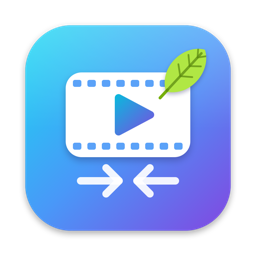
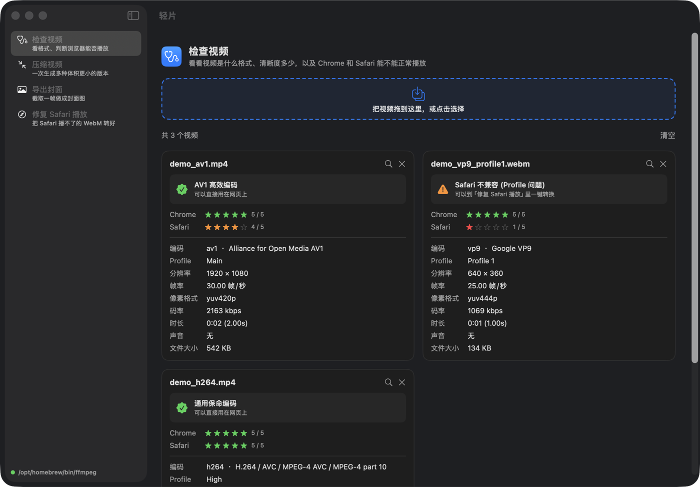
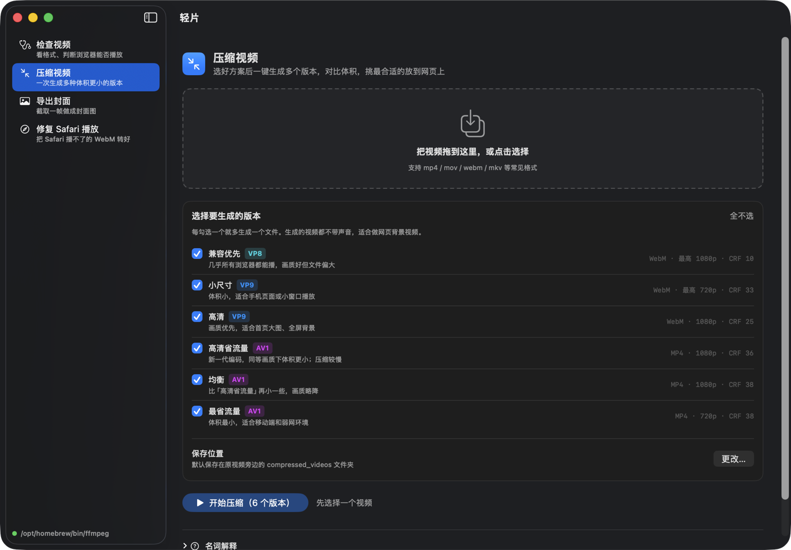
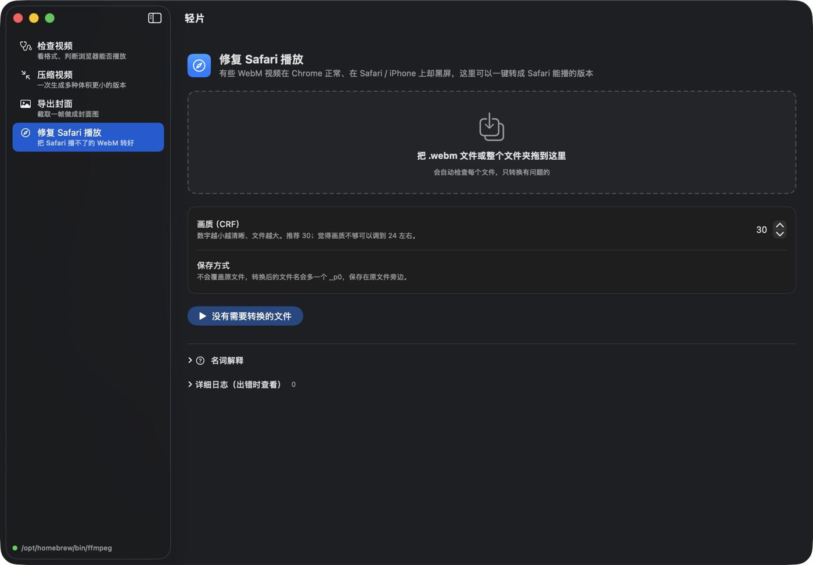

<p align="center">
  
</p>

<h1 align="center">轻片 ReelLite</h1>

<p align="center">
  把网页视频变“轻”的 macOS 小工具：检查格式、一键多方案压缩、导出封面、修复 Safari 播放。
</p>

<p align="center">
  
  
  
  
</p>

<p align="center">
  中文 · <a href="#english">English</a>
</p>

---

在网页上放视频（首页背景、产品演示、落地页动图）时，经常会遇到这些问题：

- 原视频几十 MB，页面加载太慢；
- 不知道该转成 VP9 还是 AV1，压完多大心里没数；
- 视频在 Chrome 里好好的，到了 Safari / iPhone 上却**黑屏**；
- 视频加载出来之前页面一片空白，缺一张封面图。

**轻片**把这些常用的 ffmpeg 操作做成了一个原生 macOS 应用：拖进视频，点一下按钮，就能拿到结果。每个参数旁边都写着它是干什么的，不懂视频编码也能用。



## 功能

| | 功能 | 说明 |
| --- | --- | --- |
| 🩺 | **检查视频** | 看编码、Profile、分辨率、帧率、像素格式、码率；给 Chrome 和 Safari 的兼容性打分，并告诉你下一步该怎么做 |
| 🗜️ | **压缩视频** | 一次生成最多 6 个 VP8 / VP9 / AV1 版本，实时显示进度，结果按体积排序，直接对比压缩比 |
| 🖼️ | **导出封面** | 从任意时间点截取一帧，同时导出 JPG 和静态 WebP，带预览 |
| 🧭 | **修复 Safari 播放** | 批量检查 WebM（支持整个文件夹），只把 Safari 播不了的 VP9 转成 Profile 0 + yuv420p |

其他细节：

- 支持拖放、多选，也可以把视频拖到 Dock 图标上，或在 Finder 里用“打开方式 → 轻片”；
- 任务可以随时停止，未完成的文件会自动清理；
- 不覆盖原文件，输出都保存在原视频旁边；
- 自动查找 Homebrew 安装的 ffmpeg，也可以在设置（⌘,）里手动指定路径；
- 原生 SwiftUI，无第三方依赖，支持深色模式。

<table>
  <tr>
    <td></td>
    <td></td>
  </tr>
  <tr>
    <td align="center">压缩视频</td>
    <td align="center">修复 Safari 播放</td>
  </tr>
</table>

## 安装

### 1. 安装 ffmpeg

轻片调用系统里的 ffmpeg 和 ffprobe，本身不内置 ffmpeg：

```bash
brew install ffmpeg
```

> Homebrew 版 ffmpeg 已经包含 libvpx（VP8/VP9）、libaom（AV1）和 libwebp，不需要额外配置。

### 2. 从源码构建

需要 macOS 14 以上，以及 Xcode 或 Xcode 命令行工具（`xcode-select --install`）。

```bash
git clone https://github.com/itinglight/ReelLite.git
cd ReelLite/mac-app
./build_app.sh
```

构建完成后会生成 `mac-app/build/轻片.app`，拖进「应用程序」文件夹即可。

开发调试时可以直接运行：

```bash
cd mac-app && swift run
```

## 压缩方案说明

「压缩视频」里的 6 个方案都会**去掉音轨**（适合网页背景视频），并保持原视频帧率。

| 方案 | 编码 | 输出 | 分辨率 | CRF | 适合场景 |
| --- | --- | --- | --- | --- | --- |
| 兼容优先 | VP8 | WebM | 最高 1080p | 10 | 几乎所有浏览器都能播，文件偏大 |
| 小尺寸 | VP9 | WebM | 最高 720p | 33 | 手机页面、小窗口 |
| 高清 | VP9 | WebM | 1080p | 25 | 首页大图、全屏背景 |
| 高清省流量 | AV1 | MP4 | 1080p | 36 | 同画质下体积更小，压缩较慢 |
| 均衡 | AV1 | MP4 | 1080p | 38 | 比上一档再小一点 |
| 最省流量 | AV1 | MP4 | 720p | 38 | 移动端、弱网环境 |

> **CRF** 是画质系数：数字越小画质越好、文件越大。AV1 的压缩速度明显慢于 VP9，视频较长时请耐心等待。

## 兼容性评分规则

| 编码 | Chrome | Safari | 说明 |
| --- | :---: | :---: | --- |
| H.264 | 5 | 5 | 通用编码，哪里都能播 |
| VP9（Profile 0 + yuv420p） | 5 | 5 | Safari 完美支持 |
| VP9（其他 Profile 或像素格式） | 5 | 1 | Safari 不兼容，建议用「修复 Safari 播放」转换 |
| AV1 | 5 | 4 | 新设备支持良好，老款 Apple 设备可能不支持 |
| 其他 | 0 | 0 | 未知编码 |

## 命令行脚本

轻片的功能最早来自 [`scripts/`](scripts) 里的 4 个 Bash 脚本。不想用图形界面，或者要放进自动化流程的话，可以直接用它们：

```bash
./scripts/video_inspect.sh  video.mp4         # 视频体检报告
./scripts/compress_video.sh video.mp4         # 生成 6 个压缩版本到 compressed_videos/
./scripts/export_first_frame.sh video.mp4     # 导出首帧 JPG + WebP
./scripts/vp9_to_profile0.sh video.webm       # 单个文件
./scripts/vp9_to_profile0.sh ./videos_dir     # 整个文件夹
```

> 脚本使用了 macOS 版的 `stat -f%z`，在 Linux 上需要改成 `stat -c%s`。

## 项目结构

```
.
├── scripts/                  # 原始命令行脚本
├── mac-app/                  # 轻片 macOS 应用（Swift Package）
│   ├── Package.swift
│   ├── build_app.sh          # 打包成 .app
│   ├── Resources/            # 应用图标
│   ├── scripts/make_icon.*   # 用代码生成图标
│   └── Sources/ReelLite/
│       ├── App.swift         # 入口、侧边栏、设置
│       ├── Core/             # ffmpeg / ffprobe 调用、进度解析、兼容性规则
│       ├── Features/         # 四个功能页面
│       └── UI/               # 通用组件
└── docs/images/              # README 截图
```

## 常见问题

**提示“未找到 ffmpeg”？**
从 Finder 打开的应用拿不到终端里的 PATH。轻片会自动查找 `/opt/homebrew/bin`、`/usr/local/bin`、`/opt/local/bin`；如果你的 ffmpeg 装在别处，在 设置（⌘,）里填入它所在的目录即可。

**某个压缩方案显示“失败”？**
把鼠标悬停在“失败”上可以看到原因，展开页面底部的「详细日志」能看到完整输出。最常见的原因是 ffmpeg 没有编译对应的编码器（例如 `libaom-av1`），用 Homebrew 重新安装 ffmpeg 一般就能解决。

**别人下载我打包的 .app 打不开？**
`build_app.sh` 只做了本地临时签名（ad-hoc），没有经过 Apple 公证。从网上下载的话，需要右键 → 打开，或者运行 `xattr -dr com.apple.quarantine /Applications/轻片.app`。

## 参与贡献

欢迎提 Issue 和 Pull Request！比如：

- 新增压缩方案或自定义参数；
- 保留音轨的选项；
- 支持更多语言；
- Windows / Linux 版本。

提交代码前请确认 `cd mac-app && swift build` 可以通过。

## 许可证

[MIT](LICENSE) © 2026 itinglight

轻片只是 ffmpeg 的图形界面，本身不包含 ffmpeg。ffmpeg 使用 LGPL / GPL 许可，详见 [ffmpeg.org/legal.html](https://ffmpeg.org/legal.html)。

---

<a id="english"></a>

## English

**ReelLite** is a native macOS app (SwiftUI) that makes web videos lighter. It wraps common ffmpeg workflows behind a simple drag-and-drop UI:

- **Inspect** – codec, profile, resolution, frame rate, pixel format, bitrate, plus a Chrome / Safari compatibility score.
- **Compress** – generate up to 6 VP8 / VP9 / AV1 variants at once and compare their sizes and compression ratios.
- **Export cover** – grab one frame as JPG and static WebP to use as a `poster` image.
- **Fix Safari playback** – batch re-encode VP9 WebM files to Profile 0 + yuv420p so they play in Safari and on iOS.

Requirements: macOS 14+, Xcode command line tools, and `brew install ffmpeg`.

```bash
git clone https://github.com/itinglight/ReelLite.git
cd ReelLite/mac-app && ./build_app.sh   # → build/轻片.app
```

The UI is currently in Simplified Chinese. Translations are welcome. Licensed under [MIT](LICENSE).
